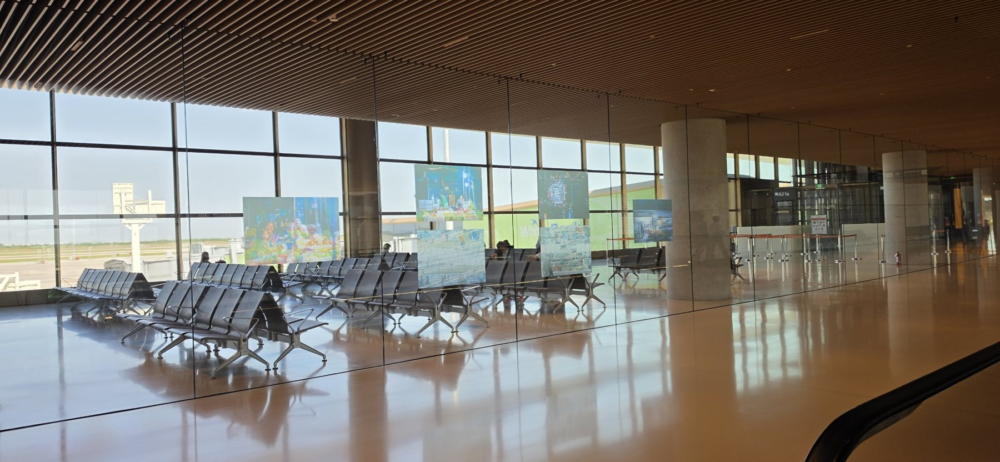
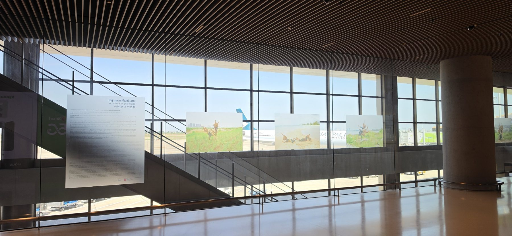

Airports are funny places. Countries spend billions building them, only for most of us to remember how long immigration took and whether the wifi worked.

But Cambodia’s Techo International Airport caught my attention for an entirely different reason.

What I particularly loved was how thoughtfully the airport made use of its glass surfaces to showcase Cambodian heritage, cultural imagery and stories. Spaces that could have easily been left empty were instead given meaning.

It was subtle, intentional and educational without feeling like a museum.

It got me thinking about airports as instruments of soft power. Before a visitor meets your people, tastes your food or walks through your streets, they meet your airport. It is arguably the first opportunity a country has to tell the world who it is, on its own terms.

Modernity doesn’t have to come at the expense of identity. A country can aspire towards the future without becoming visually indistinguishable from everywhere else.

Perhaps the measure of a great airport isn’t just how efficiently it moves people, but how much of a country stays with them when they leave.

Well done, Cambodia! 🇰🇭

<figure class="pair">
  
  
  <figcaption>At Home in the World – Cambodian photography on the glass at Techo International Airport.</figcaption>
</figure>
