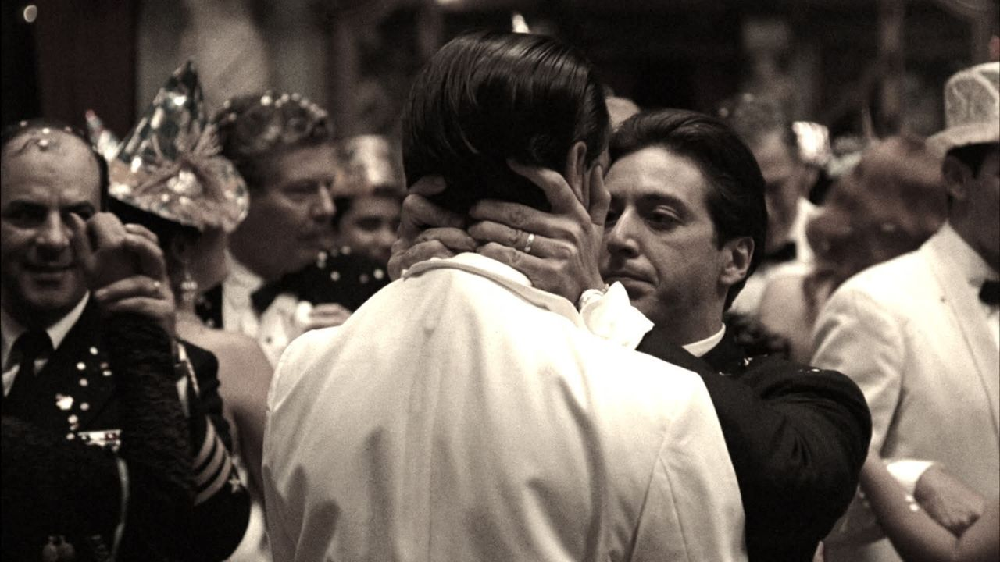

## 2026-11-07
Just this week, hackers have been found manipulating blood-storage temperatures, disrupt water systems and steal billions from cryptocurrency platforms.

While I’m genuinely concerned about where cybersecurity is heading, a small part of me can’t help but wonder how did we build a world where refrigerators, hospitals and water systems can be controlled remotely but my printer still refuses to connect to wifi 😾

tags: Technology · Ramblings

## 2026-11-04
A conversation over dinner tonight got me thinking about how entrepreneurs are a little like ants. We keep our heads down, working tirelessly to solve the problems right in front of us, hoping that if we keep going, something will grow. And perhaps we’re so consumed by the world we’re building that we rarely think to look up and question the larger forces that shape it.

I think entrepreneurs aren’t necessarily oblivious to the bigger picture… they are often simply too occupied surviving within it to question it.

We never questioned where the water came from.  
Only that it flowed.  
So we built, and borrowed, and called it growth.  
Mistaking the flow for something permanent.  
Then someone turned off the tap.  
And we discovered how little of it was ever ours.

tags: Entrepreneurship · Investing

## 2026-10-29

*"I know it was you, Fredo. You broke my heart. You broke my heart!"*

## 2026-10-28
### Conversations that shaped me.
I was 12. It’s late at night. The roads are empty. My uncle drives straight through a red light.

Me: “阿發叔叔! That’s a red light! You’re supposed to stop!”

Uncle: (cheekily) “But isn’t a traffic light just a light when there’s no traffic?”

Me: “Nooo. It’s still a traffic light! Just because there are no cars doesn’t mean it’s not one anymore.”

Uncle: “But if there are no cars, what’s the light for?”

Me: “To tell cars when to stop!”

Uncle: “But there are no cars.”

Me: “But we’re a car!”

Uncle: (laughs) “Okay, okay. But what if nobody was here? Would the light still matter?”

Me: (thinking for a while) “Hmm. Maybe it doesn’t matter. But maybe it does.”

Uncle: “How can it be both?”

Me: “I don’t know. Maybe it depends on who’s looking at it? Like, if nobody’s there, it doesn’t matter. But if someone is, then it does. So… can’t it be both?”

My uncle smiled. We drove on.

tags: Philosophy · Life

## 2026-10-25
Never get rid of a distressed asset. You just raise its value.

tags: Entrepreneurship · Investing

## 2026-10-23
### On Replay Now
*John Mayer’s Edge of Desire – the beautiful irrationality of longing.*

When I learned that John Mayer was the headliner for the Sphere residency in Las Vegas, I found myself thinking of one of my forever favourite songs. I first heard of it 17 years ago and it still evokes the same feelings today. It’s a song I’ll never get tired of.

Not because it’s his most sophisticated work. Rather, it catches the moment when an intelligent, self-aware person becomes completely irrational when he is in the presence of longing. I think it’s just so wonderfully human.

There are two lyrics I’ve always found particularly brilliant: "Just a great figure eight, or a tiny infinity.”

I think it’s such a clever way to describe the futility of all our running. All that movement, only to find ourselves going in circles… isn’t that exactly what longing feels like?

Then the image of a mattress spinning on its axis and finding itself in someone else’s bed is so absurd. JM turned something so simple, like a bed, into something cosmic. It’s like the universe will shift just to bring two people together. It is so insane, so creative, and so painfully romantic.

But what makes the song exceptional to me isn’t just its lyricism. It’s how beautifully the music carries the same emotion.

There’s something about Dadd9–A that I find difficult to put into words. It’s not quite melancholic but it isn’t entirely content either. The added ninth gives it this open suspended tenderness. Almost like a musical sigh. A feeling of wanting something without quite knowing whether it will ever arrive. The return to A feels familiar, comforting even. Yet the repetition keeps the longing alive.

And perhaps that’s what I love most about this song. It doesn’t try to make desire reasonable.

We can be intelligent, rational, principled individuals and still find ourselves wanting someone (or something) so desperately that all reason momentarily escapes us.

tags: Arts & Culture · Music

## 2026-10-22
### Fail smart, not fast.
The startup world loves telling founders to fail fast. I’ve always said we should tell founders to fail smart instead. Because here’s the thing: Founders are people too. And contrary to popular belief, our capacity to absorb disappointment, a setback, or a failure is not infinite. Resilience is not a bottomless resource either.

I’m not saying we shouldn’t fail, but I do say that we should be more selective in our failures. We should risk failure, we should take chances. Try everything, but understand what each attempt costs you beyond the financials.

And then there’s time. Perhaps the greatest luxury of all.

You can raise another round of funding. You can rebuild a company. But you can’t raise another round of your own lifetime.

So by all means, fail.

Just make sure it’s worth failing for.

tags: Entrepreneurship · Startup

## 2026-10-19
Reading a biography of a 19th-century tin magnate. Every chapter is a reminder that "disruption" used to involve actual rivers.
